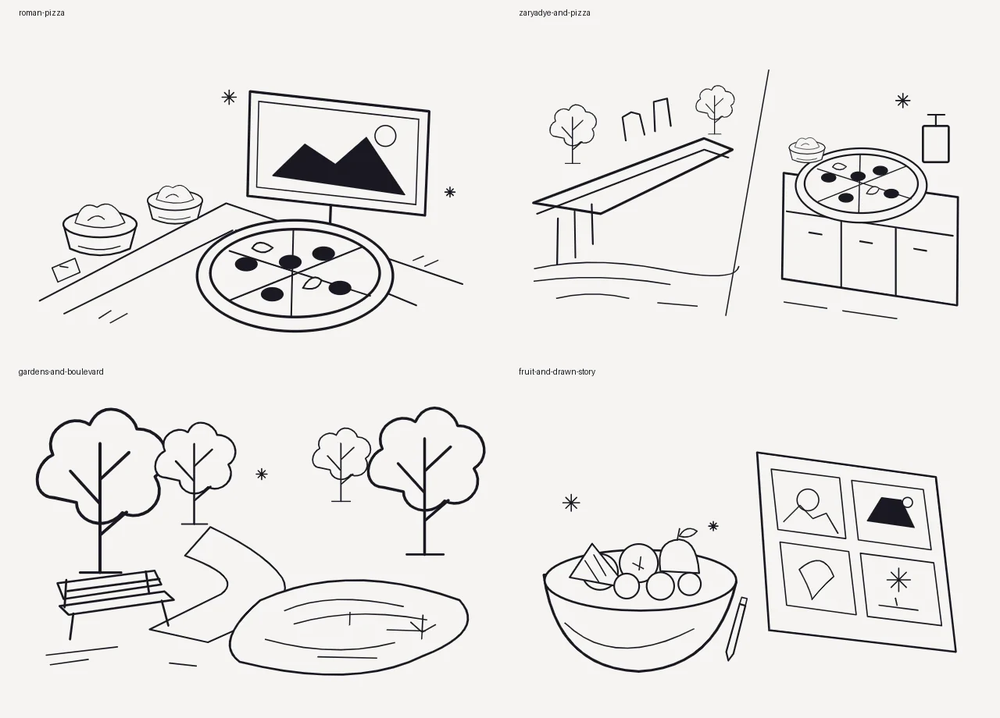

# Иллюстрации TASK-051: предложение на арт-приёмку

Статус: **на арт-приёмке**, стиль не объявляется утверждённым. Ветка task-051-idea-illustrations. В базу добавлены изображения только четырёх согласованных id, без изменения текста/состава сценариев. Merge опубликует эти поля; разрешение владельца необходимо.

## Направление

Оригинальная контурная графика: чернила #191821, бумага #f5f4f1, прозрачное пространство для подложки акцента. Без фотографий, людей, сторонних изображений, брендов и узнаваемых кадров. Мост — условный контур по брифу, не географическая схема. Все SVG нарисованы для проекта в design/illustrations/; внешние иллюстрации не использованы.

- roman-pizza: вечерний стол, два контейнера теста, пицца и экран с условным пейзажем.
- zaryadye-and-pizza: прогулка и домашняя кухня соединены диагональю.
- gardens-and-boulevard: деревья, пустая скамейка, дорожка и отражения в пруду.
- fruit-and-drawn-story: фрукты и четыре абстрактных рисованных кадра без персонажей.

Решение для акцента: WebP с прозрачностью, чернильные линии и бумажные предметы остаются постоянными; фоновый tint задаёт контейнер IdeaCard. Поэтому не нужны девять копий каждой сцены. Самостоятельное изображение остаётся читаемым на бумаге, белом и светлых акцентных подложках. Это предложение TASK-051, не новый принятый пункт ADR.

## Файлы и подключение

Все четыре id имеют `<id>-640.webp` (640×427) и `<id>-1280.webp` (1280×853). Округление высоты — до целого пикселя для пропорции 3:2. Каждый файл ≤300 000 байт; точные размеры, объём и SHA-256 в public/images/ideas/manifest.json. SVG-оригиналы и WebP — редактируемые материалы проекта, без дополнительного лицензионного платежа; исключительных юридических гарантий это не заявляет.

В day-ideas.json сохранены пути `images/ideas/<id>-640.webp` и alt-тексты из брифа. Они относительны корню public, без ведущего `/`. В React адрес строится через `import.meta.env.BASE_URL + image`; при выборе большого размера — тот же префикс и `<id>-1280.webp`. Не добавлять жёсткий домен или /images. Размеры контейнера aspect-ratio:3/2, object-fit:cover, loading=lazy для карточек ниже первого экрана. Ширина 640 — для телефона, 1280 — для большого экрана/плотности; обе версии доступны.

## Проверки

Проверены декодирование WebP, размеры, альфа-канал, лимиты и соответствие id/alt четырём записям. Общий лист и отдельные сцены просмотрены визуально. Стандартные проверки tests/README.md выполнены перед коммитом. Текущая главная не использует day-ideas: новая экранная интеграция — TASK-049/050; общий бюджет AC-DI-14 и G4/G5 проверяются на собранных экранах, не считаются пройденными наличием восьми файлов.

Что осталось: принять арт-направление либо перечислить правки; только после этого merge. Предварительное согласие на стиль не придумано.
